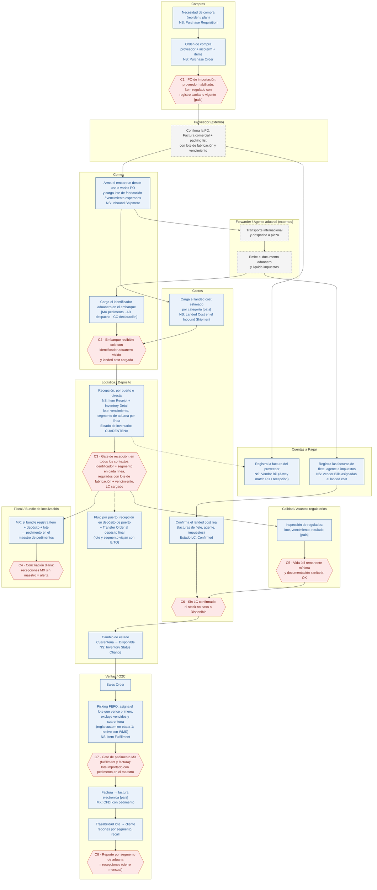

# Caso 3 · Proceso P2P regional (AR / CO / MX) → O2C

Es un solo proceso con variantes por país. Cada carril es un área: las internas y las externas (proveedor, forwarder y agente aduanal). Lo marcado como **[país]** cambia según la subsidiaria. Los hexágonos rojos **C1 a C8** son los puntos de control, descriptos en la tabla debajo del diagrama.

## Puntos de control

| # | Dónde frena | Qué valida | Tipo |
|---|---|---|---|
| C1 | Aprobación de la PO | Proveedor habilitado. Ítem regulado con registro sanitario vigente en el país de destino. | Preventivo (workflow de aprobación) |
| C2 | Inbound Shipment, al pasar a recibible | Identificador aduanero con el formato del país y landed cost cargado. | Preventivo (UE / workflow) |
| C3 | Item Receipt (`beforeSubmit`, **todos los contextos**, incluido el proceso masivo) | Segmento en cada línea igual al identificador del embarque. Regulados con lote de fabricación y vencimiento. LC cargado con las categorías obligatorias. | Preventivo, bloquea |
| C4 | Conciliación diaria | Toda recepción MX tiene fila en el maestro de pedimentos. | Detectivo, alerta |
| C5 | Inspección de Calidad | Vida útil remanente mínima y documentación sanitaria. | Preventivo (el stock queda en cuarentena) |
| C6 | Cambio de estado a Disponible | Landed cost confirmado. | Preventivo, protege el COGS |
| C7 | Item Fulfillment y Factura MX (`beforeSubmit`) | El lote importado tiene pedimento en el maestro. Es la última barrera antes del CFDI. | Preventivo, bloquea |
| C8 | Cierre mensual | Reporte por segmento = recepciones = landed cost. | Detectivo |

**Relación con el caso 1:** C7 es el gate de pedimento implementado. C3 es el gate del Item Receipt **extendido**. Hoy ese gate valida segmento por línea, LC cargado y además **LC confirmado (R2)**. En este diseño, R2 se pasa a *warn-only* en la recepción y su control pasa a C6 (cuarentena), para no frenar la recepción directa. Validar lote y vencimiento de los regulados y las categorías de LC es la extensión pendiente.
